# Evaluation results

Generated by `scripts/evaluation/make_charts.py` from the CSV files in this folder (produced by `run_experiments.py`). Dataset: 48 synthetic documents (6 categories x 8, four layouts and four fonts) under 15 controlled degradations; no real personal data.

**Limitations.** The documents are synthetic and rendered with clean TrueType fonts, and the extraction/classification rules were written by the project authors, so these numbers measure *this system on this benchmark*; they are not a claim about real-world accuracy. Use public scanned documents for the final report.

## 1. Preprocessing ablation

Cumulative pipelines, OCR error against the known text. 270 images per row (all 15 degradation conditions).

| Variant | mean CER | mean WER |
|---|---|---|
| A0 raw image | 0.1570 | 0.2093 |
| A1 + grayscale | 0.1200 | 0.1725 |
| A2 + median denoise | 0.1163 | 0.1603 |
| A3 + CLAHE | 0.1225 | 0.1657 |
| A4 + adaptive threshold | 0.1625 | 0.3049 |
| A5 + deskew | 0.0651 | 0.2071 |
| A6 + morphology | 0.0390 | 0.1510 |
| A7 + resize (R4 standard+CLAHE) | 0.0401 | 0.1505 |
| R3 default (no CLAHE) | 0.0317 | 0.1182 |
| R5 full (+ page boundary) | 0.0317 | 0.1177 |

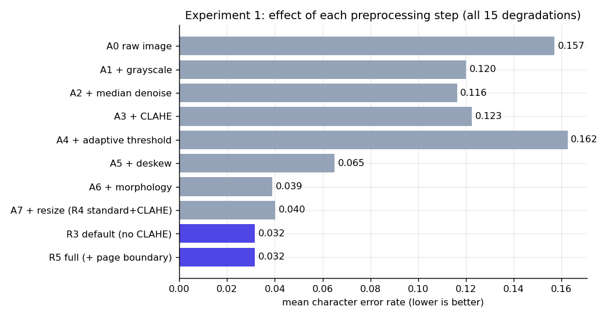

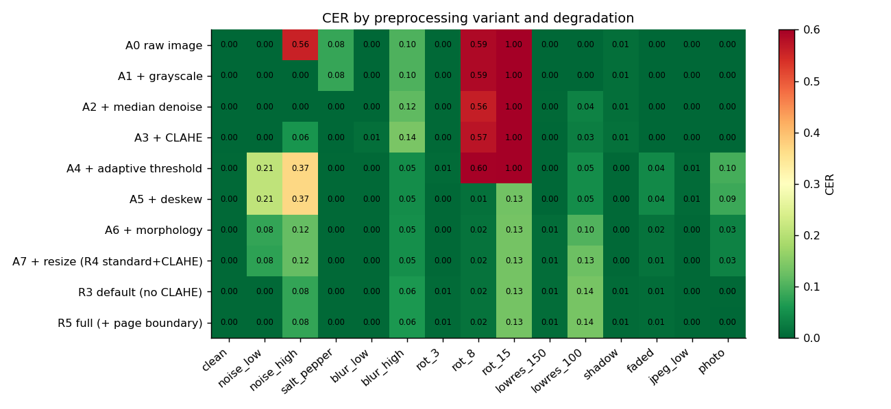

## 2. Thresholding

Mean CER. Global thresholding breaks under shadows; Otsu is excellent on noise but cannot handle uneven light; adaptive handles both.

| Method | clean | noise_high | shadow | faded | jpeg_low |
|---|---|---|---|---|---|
| raw grayscale (no threshold) | 0.002 | 0.002 | 0.011 | 0.002 | 0.002 |
| global (T=127) | 0.007 | 0.008 | 0.003 | 1.000 | 0.007 |
| Otsu | 0.006 | 0.006 | 0.012 | 0.006 | 0.004 |
| adaptive | 0.003 | 0.219 | 0.003 | 0.003 | 0.002 |

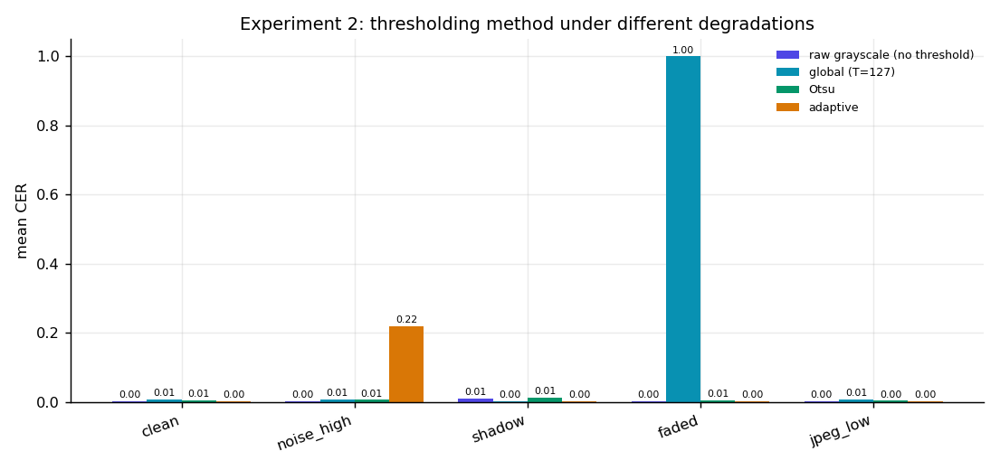

## 3. Denoising

PSNR/SSIM compare the denoised grayscale page with the clean original; CER is after thresholding and OCR.

| Method | PSNR dB | SSIM | CER |
|---|---|---|---|
| none | 28.69 | 0.645 | 0.0309 |
| Gaussian 5x5 | 29.53 | 0.819 | 0.2381 |
| median 3 | 35.57 | 0.942 | 0.0748 |
| median 5 | 30.73 | 0.967 | 0.0168 |
| non-local means | 29.40 | 0.759 | 0.0303 |

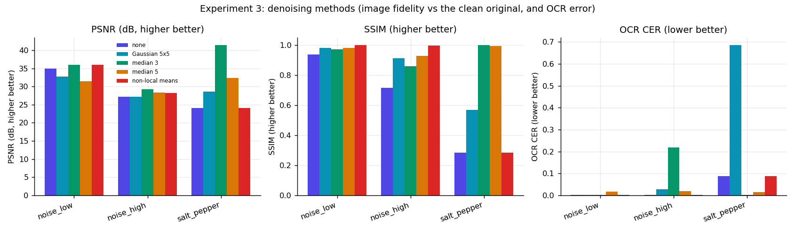

## 4. Skew correction

Mean angle error **0.04 degrees** (max 0.50).

| Condition | angle error (deg) | CER with deskew | CER without |
|---|---|---|---|
| clean | 0.00 | 0.0037 | 0.0037 |
| rot_3 | 0.05 | 0.0056 | 0.0061 |
| rot_8 | 0.04 | 0.0159 | 0.5628 |
| rot_15 | 0.09 | 0.1340 | 0.9940 |

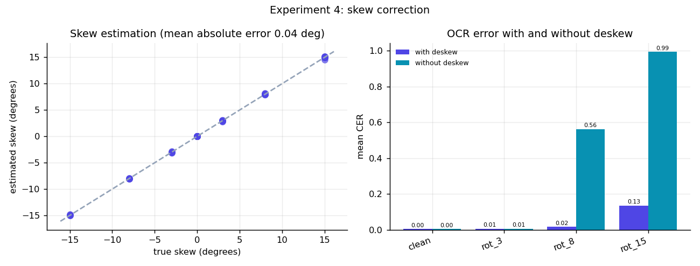

## 5. Resolution

Mean CER by simulated scan resolution (200 DPI is the full-size page).

| Variant | 200 DPI | 150 DPI | 100 DPI | 70 DPI | 50 DPI |
|---|---|---|---|---|---|
| grayscale only | 0.002 | 0.002 | 0.002 | 0.012 | 0.704 |
| grayscale + upscale | 0.002 | 0.002 | 0.002 | 0.003 | 0.025 |
| default pipeline | 0.004 | 0.008 | 0.141 | 0.633 | 0.782 |

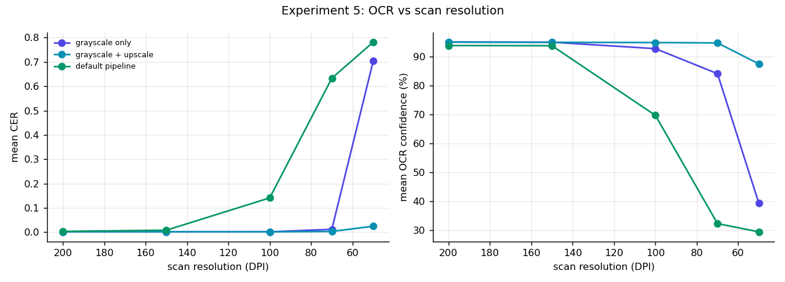

## 6. Phone photos (boundary detection and perspective)

Page outline found in **100.0%** of 48 photos; mean IoU with the true page **0.99**.

| Variant | mean CER |
|---|---|
| raw image | 0.0014 |
| R3 default | 0.0019 |
| R5 full (boundary + perspective) | 0.0016 |

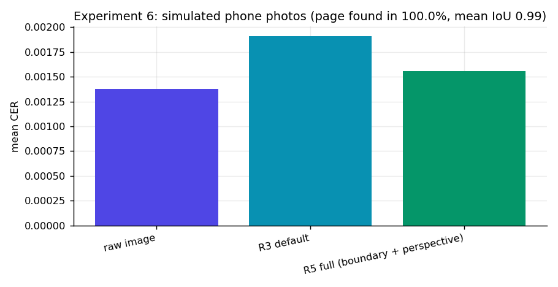

## 7. Page segmentation mode

| Mode | insurance_policy | claim_form | identity_document | medical_bill | repair_invoice | other |
|---|---|---|---|---|---|---|
| PSM 3 | 0.0029 | 0.0039 | 0.0000 | 0.0020 | 0.0048 | 0.0047 |
| PSM 4 | 0.0029 | 0.0039 | 0.0000 | 0.0020 | 0.0048 | 0.0047 |
| PSM 6 | 0.0029 | 0.0039 | 0.0000 | 0.0020 | 0.0048 | 0.0047 |
| PSM 11 | 0.0029 | 0.0039 | 0.0015 | 0.0020 | 0.0048 | 0.0047 |

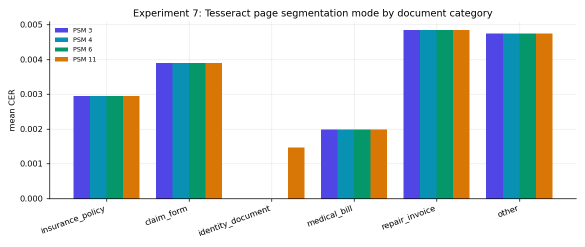

## 8. Document classification

End to end: the page is processed and OCR'd, then classified from the recognised text. 720 images.

| Method | overall accuracy |
|---|---|
| keyword | 99.2% |
| ml | 100.0% |
| hybrid | 99.4% |

Hybrid per-class results:

| Category | precision | recall | F1 |
|---|---|---|---|
| insurance_policy | 1.000 | 1.000 | 1.000 |
| claim_form | 1.000 | 1.000 | 1.000 |
| identity_document | 1.000 | 0.975 | 0.987 |
| medical_bill | 1.000 | 1.000 | 1.000 |
| repair_invoice | 1.000 | 0.992 | 0.996 |
| other | 0.968 | 1.000 | 0.984 |

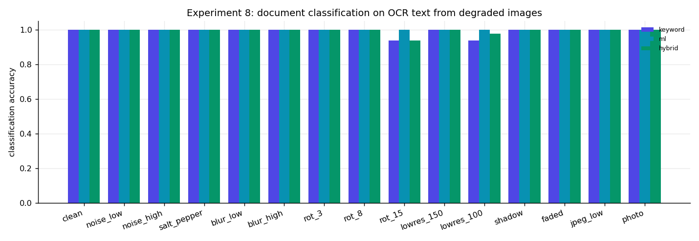

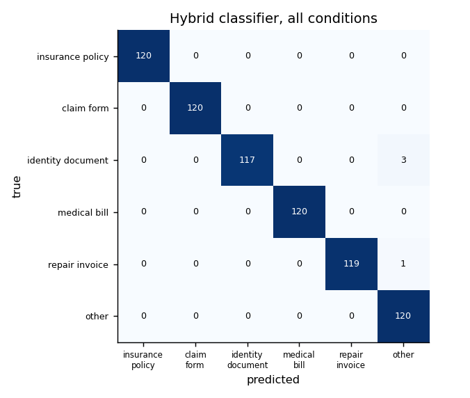

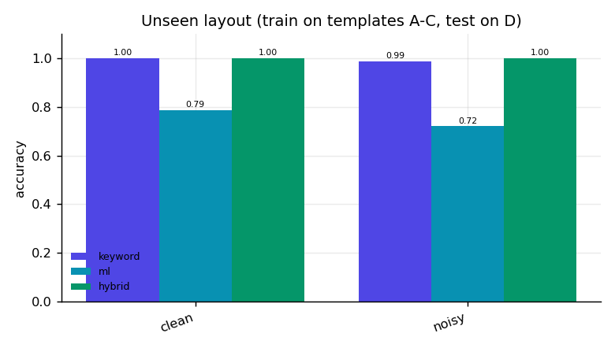

## 9. Field extraction

Overall accuracy **88.6%** with the true category, **88.5%** when the system's own predicted category is used.

| Category | field accuracy |
|---|---|
| insurance_policy | 87.9% |
| claim_form | 89.4% |
| identity_document | 88.3% |
| medical_bill | 90.7% |
| repair_invoice | 87.0% |

Weakest fields:

| Field | accuracy |
|---|---|
| repair_invoice.vehicle_details | 53.3% |
| claim_form.customer_name | 70.0% |
| insurance_policy.customer_name | 79.2% |
| identity_document.id_number | 80.8% |
| insurance_policy.insurance_company | 80.8% |
| identity_document.name | 82.5% |
| medical_bill.hospital_name | 82.5% |
| identity_document.date_of_birth | 85.0% |

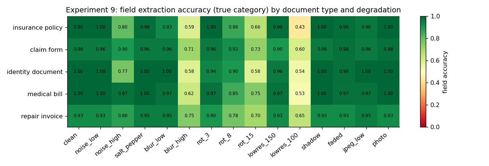

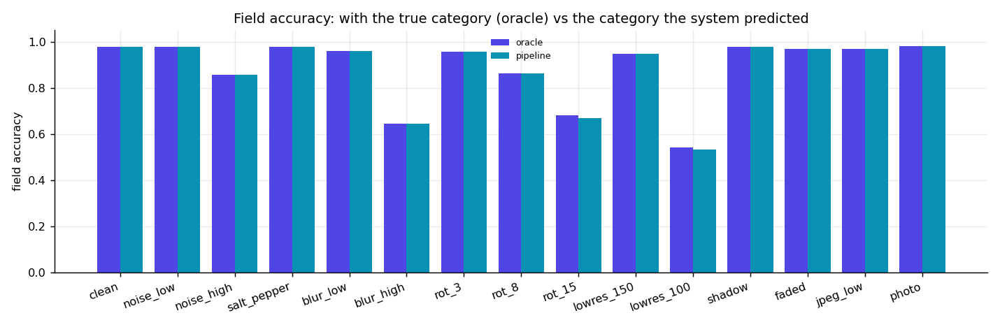

## 10. Processing time

Mean milliseconds per page (single process, no contention).

| Stage | 200 DPI (1654 px) | 300 DPI (2481 px) |
|---|---|---|
| grayscale | 2 | 3 |
| denoise | 2 | 4 |
| threshold | 63 | 135 |
| deskew | 78 | 76 |
| morphology | 6 | 15 |
| resize | 2 | 0 |
| OCR (Tesseract) | 325 | 395 |
| classify | 12 | 5 |
| extract | 2 | 1 |
| validate | 0 | 0 |
| **total** | **492** | **634** |

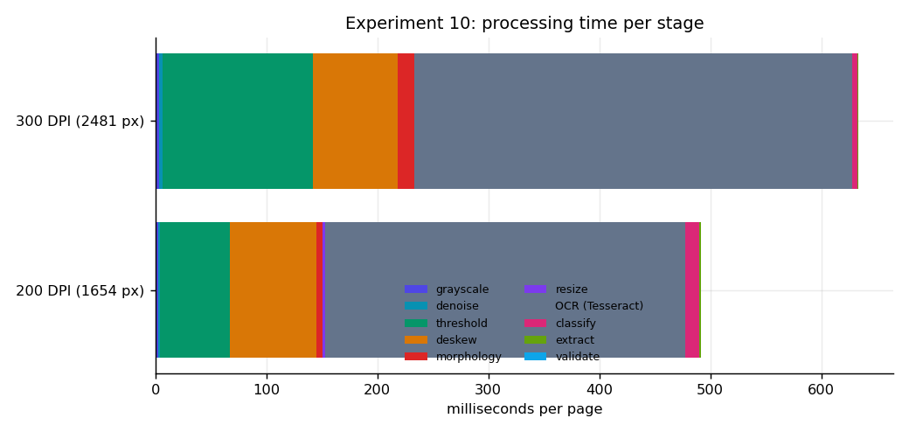

## 11. Validation

360 documents with known defects (and clean controls). Review-status accuracy **100.0%**.

| Rule | TP | FP | FN | precision | recall |
|---|---|---|---|---|---|
| CLAIM_NUMBER_MISSING | 30 | 0 | 0 | 1.00 | 1.00 |
| DATE_ORDER | 30 | 0 | 0 | 1.00 | 1.00 |
| FUTURE_DATE | 30 | 0 | 0 | 1.00 | 1.00 |
| INVALID_AMOUNT | 60 | 0 | 0 | 1.00 | 1.00 |
| INVALID_DATE | 30 | 0 | 0 | 1.00 | 1.00 |
| LOW_CONFIDENCE_FIELD | 30 | 30 | 0 | 0.50 | 1.00 |
| LOW_OCR_CONFIDENCE | 30 | 0 | 0 | 1.00 | 1.00 |
| MISSING_FIELD | 30 | 0 | 0 | 1.00 | 1.00 |
| POLICY_EXPIRED | 30 | 0 | 0 | 1.00 | 1.00 |
| POLICY_NUMBER_MISSING | 30 | 0 | 0 | 1.00 | 1.00 |

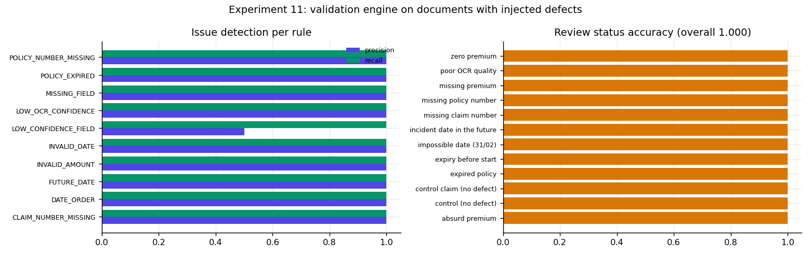
